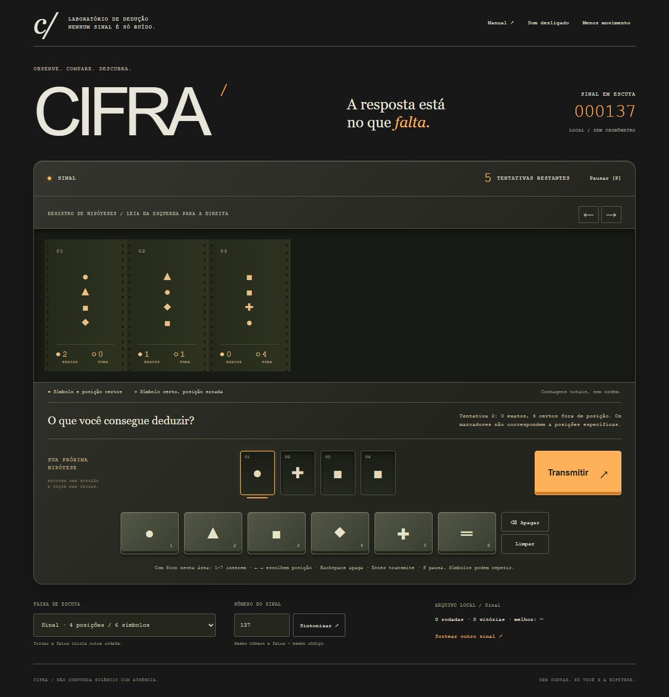

# Cifra

**A resposta está no que falta.**

[Jogar gratuitamente](https://gustapaz.github.io/cifra/)



Jogo de dedução de símbolos com fita horizontal de hipóteses, feedback agregado e painel de teclas. Descubra um código oculto comparando suas tentativas. Símbolos podem se repetir; cada ocorrência conta uma vez no retorno.

## Modos e regras

| Faixa | Posições | Símbolos | Tentativas |
| --- | --- | --- | --- |
| Sinal | 4 | 6 | 8 |
| Ruído | 5 | 7 | 10 |

**● Exatos:** símbolo e posição certos. **○ Fora:** símbolo presente, em outra posição. Os marcadores são contagens totais e não correspondem às posições do palpite. Exemplo: código ● ▲ ● ■ e hipótese ● ● ◆ ■ dão dois exatos e um fora.

Monte uma hipótese e transmita. Incompletas e repetidas não consomem tentativa. Descobrir todos os símbolos vence, inclusive na última tentativa. Esgotar o limite revela o código e encerra a rodada. Não há cronômetro ou compra de tentativas.

O mesmo número de sinal e faixa reproduzem o código. **Repetir código** limpa a rodada mantendo o código atual; **Sintonizar** aplica o número digitado; **Sortear outro sinal** escolhe outro número localmente. Trocar faixa começa outra rodada. O código é parte do jogo executado no cliente, não um segredo de segurança ou criptografia real.

## Controles

Clique/toque nas posições e teclas de símbolo. Na área de dedução focada, **1–7** inserem, **←/→** mudam posição, **Backspace** apaga e **Enter** transmite. **P** pausa; **Escape** retoma/fecha manual. Menus funcionam por Tab/Enter. Histórico tem rolagem horizontal própria e botões anterior/recente. Não há arraste ou gamepad.

Som procedural opcional começa desligado. Movimento reduzido suprime animação das hipóteses e rolagem suave; também respeita preferência do sistema. A perda de foco pausa a rodada e exige retorno explícito.

## Stack e execução

**Alpine.js CSP 3.17.5 + JavaScript + CSS/DOM + Vite 8.3.5.** Build CSP evita liberar `unsafe-eval`. Modelo puro separado da interface; renderização por estado, sem loop contínuo, Canvas/WebGL ou servidor. Fontes do sistema, arte e áudio procedurais.

Node 24:

```sh
npm ci
npm test
npm run build
npm run dev
```

Dev em `http://127.0.0.1:4203/`; `npm run preview` serve o export na porta 4204. Harness local `/tests/browser.html` usa iframe da própria origem e somente o save desta origem de teste. Não entra no export. Publicação usa apenas `dist/`, com caminhos relativos para `/cifra/`.

## Privacidade, gratuidade e licença

Estatísticas por faixa e preferências ficam no `localStorage`, validadas antes de uso. Save corrompido é descartado; falha no armazenamento não impede jogar. A tentativa atual não persiste após reload. Histórico local é modificável pelo usuário e não constitui ranking online confiável.

Sem contas, backend, API de consumo, telemetria, fontes/imagens remotas, compras, cartão, faturamento ou trial. GitHub Pages de repositório público disponível no GitHub Free ([documentação](https://docs.github.com/en/pages/getting-started-with-github-pages/what-is-github-pages)); o host mantém seus próprios logs. Sem garantia de gratuidade permanente ou funcionamento offline.

Código/arte originais MIT; licenças Alpine/Vue preservadas em `third-party.txt`. Mecânica da família genérica de quebra-códigos, sem copiar marca, fases, código ou ativos comerciais. [Design](docs/game-design.md), [assets](docs/assets.md), [validação](docs/validation.md).
